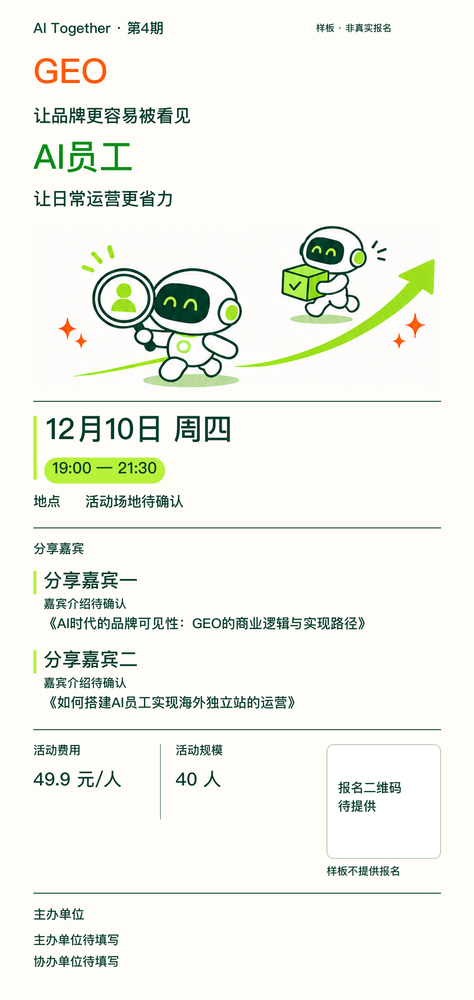

# AI Together 活动海报 Skill

**AI Together · AI同行社**

先询问、再确认、后制作。适用于系列活动海报，不涉及其他项目。



这是匿名样板：没有真实嘉宾姓名、公司名称或实际报名二维码，日期与费用仅用于展示版式，不构成活动通知。

## 使用

安装为 Codex skill 后说：

> 用 AI同行社海报 skill 制作第四期海报。

助手会先询问尚未提供的主题、受众、日期时间、地点、嘉宾与分享题目、费用、人数、报名入口、主办单位和风格。信息齐备后回显上图文案，得到确认才开始制作。已有信息不会重复询问；主题未定会提供提案；待定信息只能用于标明预览的样稿。

## 安装

将本仓库克隆到 Codex 的 skills 目录，目标文件夹名保持 `ai-together-poster`，例如：

```bash
git clone https://github.com/brucegu17/ai-together-poster.git ~/.codex/skills/ai-together-poster
```

不要覆盖已有同名 skill。安装后重新加载支持 skills 的会话。也可显式调用 `$ai-together-poster`。

## 确定性排版

Python 3.10+，依赖见 requirements.txt。建议在独立虚拟环境安装依赖：

```bash
python3 -m venv .venv
.venv/bin/pip install -r requirements.txt
.venv/bin/python scripts/render.py --input examples/sample.json --out output/sample-v1
```

文字来自 JSON，并用标准字体绘制；AI 插画与文字分开。macOS 可自动发现苹方，其他系统可指定本机的中文字体：

```bash
python scripts/render.py --input event.json --out output/event-v1 --font /path/to/font.ttf --font-index 0
```

脚本不下载、不安装、不上传字体。输出记录字体哈希和索引，后续版本应使用同一字体。正式稿加 `--final`，要求确认标志、完整信息和可解码的原始二维码；脚本还会核验成品二维码。新增版本必须使用新目录。

输出：`poster.png`、`event.json`、`layout.json`、`verification.json`。JSON 是可编辑源；自动校验不替代肉眼审稿。二维码模块直接来自提供的图片，不能由图像生成工具重画。

## 资源与范围

`assets/robots.png` 是本流程生成并从无文字插画区域提取的示例素材。仓库未包含系统字体。样板可用于观察风格，不能用来报名。当前 renderer 支持本样板的两组主题与一至四位嘉宾；超长文本会明确报错，应调整布局后再输出，不默默截断。

创建公开仓库不等于授权自动公开今后的活动资料。每期文件应放在独立输出目录，不能混入其他项目；不上传未经授权的活动数据。

## 验证

```bash
python3 -m unittest discover -s tests -v
```

测试确认：日期矛盾被阻止、占位稿不能作为最终稿、单个名称变化不会改变无关区域、长文本不会静默截断、样板不含真实报名入口。
